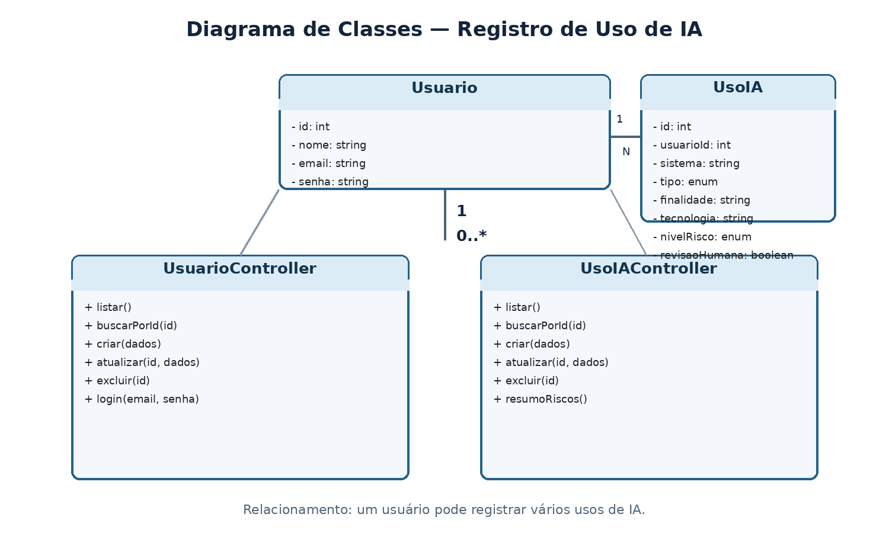

# Registro de Uso de IA

## Descrição
Back-end desenvolvido em Node.js, Express e MariaDB para cadastrar usuários, realizar login, registrar usos de Inteligência Artificial e consultar a quantidade de registros por nível de risco.

## Diagrama de Classes


## Tecnologias
- Node.js
- JavaScript
- Express
- MariaDB
- mysql2
- Insomnia ou Postman

## Estrutura do projeto
```text
backend_usos_ia/
├── db/
│   └── script.sql
├── docs/
│   ├── der_uso_ia.png
│   └── diagrama_classes.png
├── src/
│   ├── controllers/
│   │   ├── usuario.js
│   │   └── usoia.js
│   ├── db.js
│   └── routes.js
├── .gitignore
├── package.json
├── README.md
└── server.js
```

## Como configurar e testar

1. Instale o Node.js e o MariaDB (ou inicie o MariaDB pelo XAMPP).
2. Abra o terminal na pasta do projeto.
3. Execute o arquivo `db/script.sql` no HeidiSQL, DBeaver, Workbench compatível ou phpMyAdmin para criar o banco `usos_ia` e inserir os dados de exemplo.
4. Confira em `src/db.js` o usuário e a senha do MariaDB. Por padrão, está configurado como usuário `root` sem senha.
5. Instale as dependências:
   ```bash
   npm install
   ```
6. Inicie a API:
   ```bash
   npm start
   ```
7. Acesse `http://localhost:3000` no navegador. Deve aparecer uma mensagem informando que a API está funcionando.
8. No Insomnia ou Postman, envie as requisições abaixo. Todas as rotas usam `http://localhost:3000`.

## Rotas da API

### Usuários
| Método | Rota | Função |
|---|---|---|
| GET | `/usuarios` | Lista usuários sem exibir senhas |
| GET | `/usuarios/1` | Busca usuário pelo ID |
| POST | `/usuarios` | Cadastra usuário |
| PUT | `/usuarios/1` | Atualiza usuário |
| DELETE | `/usuarios/1` | Exclui usuário |
| POST | `/login` | Realiza login |

Exemplo de JSON para `POST /usuarios`:
```json
{
  "nome": "João da Silva",
  "email": "joao@email.com",
  "senha": "123456"
}
```

Exemplo de JSON para `POST /login`:
```json
{
  "email": "maria.oliveira@email.com",
  "senha": "senha123"
}
```

### Usos de IA
| Método | Rota | Função |
|---|---|---|
| GET | `/usos-ia` | Lista os usos de IA |
| GET | `/usos-ia/1` | Busca um uso pelo ID |
| POST | `/usos-ia` | Cadastra um uso |
| PUT | `/usos-ia/1` | Atualiza um uso |
| DELETE | `/usos-ia/1` | Exclui um uso |
| GET | `/resumo-riscos` | Conta registros por nível de risco |

Exemplo de JSON para `POST /usos-ia`:
```json
{
  "usuarioId": 1,
  "sistema": "Chatbot escolar",
  "tipo": "Escola",
  "finalidade": "Responder dúvidas dos alunos",
  "tecnologia": "IA generativa",
  "nivelRisco": "Baixo",
  "revisaoHumana": true
}
```

Valores aceitos:
- `tipo`: `Empresa`, `Escola` ou `Outros`.
- `nivelRisco`: `Baixo`, `Medio` ou `Alto`.
- `revisaoHumana`: `true` ou `false`.

## Testes para os prints
Faça as requisições no Insomnia/Postman e tire prints mostrando:
1. `GET /usuarios` com a lista de usuários.
2. `POST /login` com login realizado.
3. `POST /usos-ia` com cadastro concluído.
4. `GET /usos-ia` com os registros.
5. `GET /resumo-riscos` com as contagens.

Cole os prints nesta seção:
### Prints dos testes
Prints tirados no Insomnia e estão nas pastas prints_insomnia

## Observação
O script fornecido pela atividade usa a função `PASSWORD()` do MariaDB para gravar a senha. O cadastro e o login deste projeto usam a mesma função para manter compatibilidade com esse script. Em uma aplicação real, o recomendado é utilizar uma biblioteca própria para hash de senhas, como bcrypt.
